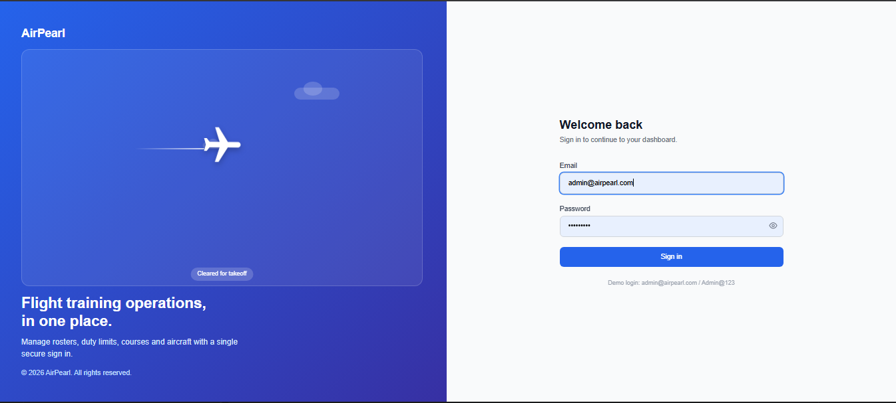

# AirPearl: Flight Training Operations Portal

A multi-module web app for managing flight training operations in one place: crew roster, FDTL compliance, courses, and lead management. Built with Angular and Tailwind CSS as a personal learning project.

**Live demo:** https://shivam1908d.github.io/airpearl-lead-management/

> **Note:** All data in this app is demo data created by me. There is no backend or real API. Authentication is a mock flow for demonstration only.

## Demo login

| Email | Password |
| --- | --- |
| `admin@airpearl.com` | `Admin@123` |

## Screenshots

| Login | Roster |
| --- | --- |
|  |  |

| FDTL Compliance | Lead Management |
| --- | --- |
|  |  |

| Courses |
| --- |
|  |

## Features

### Implemented

- **Login and authentication (mock):** split-screen login page with an animated aircraft, show/hide password, loading delay, and error message for wrong credentials. An auth guard protects the dashboard pages, and logout clears the session.
- **Roster:** weekly crew roster grid by time slot, "Assign crew" form (date, person, role, aircraft, start and end time), search crew, and filter by role.
- **FDTL Compliance:** summary cards (total crew, compliant, attention required, violations, upcoming duties), system status panel, crew compliance list with search and filters (status, role, base), and date range selector.
- **Lead Management:** overview with lead stage funnel and activity metrics, daily ad spend overview, leads table with source and stage filters, search, and export.
- **Courses:** course list with category filter, search, sortable columns, enrollment progress bars, status tags (Active, Upcoming, Archived), and an "Add course" option.
- **Layout:** collapsible sidebar, header with user avatar, and breadcrumb navigation.

### In progress

- Executive Dashboard
- Aircraft
- Leave Management
- User Management
- Instructor
- Students

## Tech stack

- Angular 17 (standalone components, routing, route guard)
- TypeScript
- Tailwind CSS 3
- PrimeNG 17 and PrimeIcons
- RxJS
- Deployed on GitHub Pages using `angular-cli-ghpages`

## Project structure

```
src/app
├── auth              # login page, auth service (mock), auth guard
├── feature           # feature modules
└── layout
    ├── breadcrumb
    ├── dashboards    # roster, fdtl, lead-management, executive-dashboard
    ├── header
    ├── sidebar
    ├── leave
    ├── training-program
    └── users
```

## Getting started

```bash
# Clone the repository
git clone https://github.com/shivam1908d/airpearl-lead-management.git
cd airpearl-lead-management

# Install dependencies
npm install

# Start the dev server
ng serve
```

Open `http://localhost:4200/` and sign in with the demo login above.

## Build

```bash
ng build --base-href /airpearl-lead-management/
```

## Notes

- The FDTL dashboard runs in demo mode. Its calculations use mock data and are for interface demonstration only. It does not establish legal or regulatory compliance.
- The mock login stores a demo token in the browser's local storage. A real version would get this from a backend API.
- AirPearl is a personal learning project. It is not affiliated with any company or organization that uses a similar name.

## Author

**Shivam Dubey**
GitHub: [@shivam1908d](https://github.com/shivam1908d)